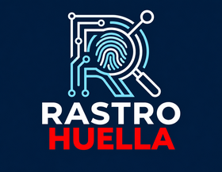
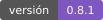
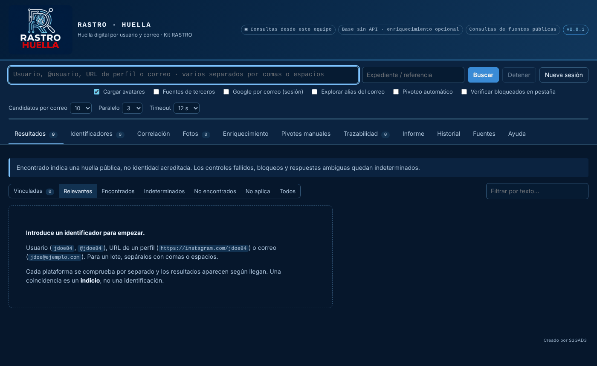
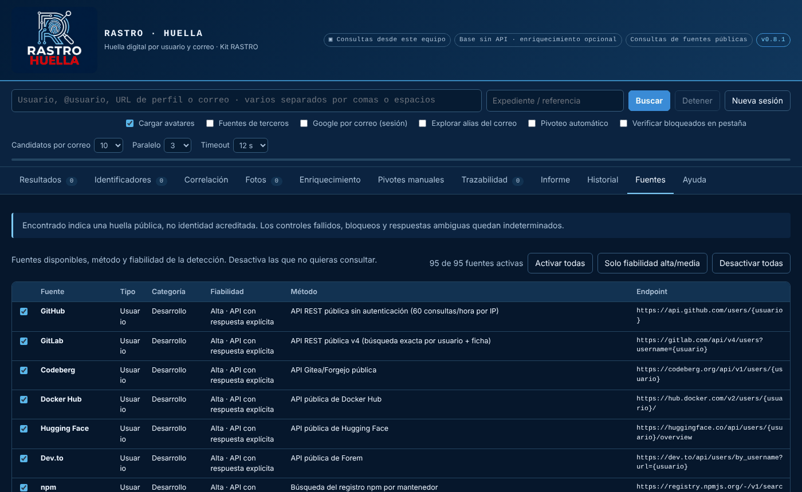

# RASTRO · HUELLA



Huella digital por **nombre de usuario** y **correo electrónico** en fuentes abiertas, desde tu navegador, con **trazabilidad de cada petición** e **informe con hash**.

   

---

RASTRO · HUELLA es una extensión para Chrome, Edge y Brave (Manifest V3) pensada para la **investigación en fuentes abiertas (OSINT)**. Comprueba un alias o un correo en decenas de plataformas a la vez, extrae los datos públicos de cada perfil, descubre nuevos identificadores para seguir pivotando y genera un informe verificable.

Funciona como Sherlock, Maigret o Holehe, pero **íntegramente en el navegador**: sin servidor intermedio, sin instalar Python y sin claves de API obligatorias. Forma parte del Kit RASTRO.



## Índice
- [Qué hace](#qué-hace)
- [Instalación](#instalación)
- [Uso](#uso)
- [Cómo interpretar los resultados](#cómo-interpretar-los-resultados)
- [Seguridad operativa y privacidad](#seguridad-operativa-y-privacidad)
- [Evidencias e informes](#evidencias-e-informes)
- [Limitaciones](#limitaciones)
- [Desarrollo](#desarrollo)
- [Uso responsable](#uso-responsable)
- [Licencia y créditos](#licencia-y-créditos)

## Qué hace

**Por nombre de usuario** (78 adaptadores): GitHub, GitLab, Instagram, TikTok, X, Facebook, Bluesky, Mastodon, Reddit, Telegram, YouTube, Twitch, Steam, Duolingo, Roblox, Chess.com, Pinterest, Linktree, foros españoles (Forocoches, Mediavida, EOL, Menéame…) y muchas más. Cada positivo se contrasta con un **alias aleatorio inexistente** para descartar plataformas que «encuentran» cualquier cosa.

**Por correo** (17 adaptadores), solo con métodos que **no avisan al titular**:
- **Google** (opcional, con sesión): nombre, foto de perfil, portada, GAIA ID y reseñas de Google Maps.
- Perfiles con correo público exacto: GitHub, GitLab, Gravatar, claves PGP, npm, commits de GitHub.
- Indicios de registro: X, Spotify, Pinterest, Proton Mail, Duolingo, Mozilla, WordPress.com.
- Infraestructura: DNS/MX del dominio, autodescubrimiento de Microsoft 365, dominios desechables.

**Además**
- **Pivoteo**: los usuarios, correos y enlaces que aparecen en un perfil se pueden buscar con un clic, o automáticamente (hasta 5).
- **Correlación**: nombres, ubicaciones, dominios enlazados, cronología de altas y **avatares coincidentes** (hash perceptual).
- **Fotos**: galería de fotos de perfil y portadas en alta resolución, descarga con SHA-256, ZIP con manifiesto y búsqueda inversa.
- **Verificación en pestaña** para plataformas que bloquean (Cloudflare, muros de sesión, páginas que solo se pintan con JavaScript).
- **Pivotes manuales**: búsquedas preparadas en Google, Bing, DuckDuckGo, HIBP, Epieos, Intelligence X, Wayback Machine…
- **Enriquecimiento opcional** con OSINT Industries (clave propia).



## Instalación

### Desde una versión publicada (recomendado)
1. Descarga `RASTRO-HUELLA-vX.Y.Z.zip` de [Releases](../../releases) y, si quieres, comprueba su SHA-256 con el fichero `.sha256` adjunto.
2. Descomprímelo en una carpeta fija (p. ej. `C:\KitRastro\RASTRO-HUELLA`).
3. Abre `chrome://extensions` (o `edge://extensions`), activa **Modo desarrollador** → **Cargar descomprimida** → elige la carpeta que contiene `manifest.json`.
4. Pulsa el icono de la extensión: se abre la consola de investigación.

**Actualizar**: sustituye los ficheros de la carpeta y pulsa ⟳ en la tarjeta de la extensión.

### Desde el código
```bash
git clone https://github.com/TU_USUARIO/rastro-huella.git
```
y carga la carpeta `extension/` con **Cargar descomprimida**.

## Uso
- Escribe un alias, `@alias`, la URL de un perfil o un correo y pulsa **Intro**. Para un **lote**, sepáralos con comas, espacios o saltos de línea.
- También: selecciona texto en cualquier web → clic derecho → **RASTRO HUELLA: buscar**.
- **Esc** o **Detener** cancelan las peticiones en curso.
- Indica el **expediente / referencia**: aparece en el informe y en los nombres de fichero.

| Opción | Qué hace |
|---|---|
| Cargar avatares | Muestra las fotos y calcula su hash perceptual para la correlación |
| Fuentes de terceros | Consulta X mediante FxTwitter / vxTwitter (reciben el alias) |
| Google por correo (sesión) | Nombre y foto de la cuenta Google del correo. Ver [seguridad operativa](#seguridad-operativa-y-privacidad) |
| Explorar alias del correo | Busca hasta 3 alias derivados de la parte local del correo (hipótesis) |
| Pivoteo automático | Busca hasta 5 identificadores descubiertos en los perfiles |
| Verificar bloqueados en pestaña | Abre en segundo plano las fuentes bloqueadas y las lee con el navegador |

## Cómo interpretar los resultados
| Estado | Significado |
|---|---|
| **ENCONTRADO** | La plataforma confirma la cuenta y el control con alias inexistente ha salido bien. Es un **indicio**, no una identificación. |
| **INDETERMINADO** | Bloqueo, sesión obligatoria, límite de peticiones, respuesta ambigua o control fallido. Revísalo a mano o en pestaña. |
| **NO ENCONTRADO** | La plataforma indica que no existe. Solo se refiere a esa comprobación. |
| **NO APLICA** | El identificador no cumple el formato de la plataforma. |

Cada cuenta encontrada lleva un **nivel de vínculo**:
- **Alto**: correo exacto publicado en el perfil o enlaces recíprocos entre perfiles.
- **Medio**: nombre completo o avatar coincidentes (puede ser un homónimo o una imagen copiada).
- **Solo alias**: existe una cuenta con ese alias, pero nada la relaciona con el objetivo.

Que un alias exista en varias plataformas **no prueba** que pertenezca a la misma persona.

## Seguridad operativa y privacidad
- Las peticiones salen **desde la IP y el navegador de este equipo**. Usa la infraestructura de navegación no atribuible que prevea tu organización.
- Las consultas directas **no envían tus cookies** (`credentials: omit`) y se elimina la cabecera `Origin`.
- **Verificación en pestaña** (y las fuentes X, Facebook e Instagram en pestaña): la visita **usa la sesión de ese navegador**. Si tienes sesión iniciada en la plataforma, la visita se hace con esa cuenta. Usa un **perfil de navegador de investigación** sin sesiones personales.
- **Google por correo**: abre `photos.google.com` en una pestaña de fondo y consulta, con la sesión de Google del navegador, la API interna que usan las webs de Google para mostrar un contacto. El titular **no** recibe aviso, pero **Google registra la consulta en la cuenta con sesión iniciada**: usa siempre una **cuenta de investigación**. Es una API no documentada y puede dejar de funcionar sin aviso.
- **Fuentes de terceros**, **enriquecimiento** y **búsqueda inversa** envían el dato a ese servicio, y solo cuando lo activas o pulsas.
- Nada se envía a servidores del proyecto: no los hay. La sesión y el historial se guardan solo en el navegador.

## Evidencias e informes
- **Trazabilidad**: cada petición queda registrada con hora UTC, fuente, URL, código HTTP, tiempo, tamaño y **SHA-256 del cuerpo**.
- **Informe TXT / HTML / JSON**: el TXT termina con su propio SHA-256. Para verificarlo, quita la última línea y calcula el hash del resto (`head -n -1 informe.txt | sha256sum`).
- **Evidencias (JSON)**: respuestas originales de los positivos con hora y hash (solo durante la sesión en curso).
- **CSV de entidades y relaciones** para i2 Analyst's Notebook, Maltego o Gephi.
- **Fotos (ZIP)**: imágenes con `manifiesto.csv` (fuente, URL, bytes, MIME, SHA-256, hora) y el SHA-256 del ZIP en pantalla.

Los hashes de texto se calculan sobre el cuerpo decodificado en UTF-8, no sobre una captura de red. Acompaña los hallazgos relevantes con tus capturas y procedimientos habituales.

## Limitaciones
- Las plataformas cambian sin aviso. Una fuente puede pasar a quedar siempre indeterminada hasta que se actualice su adaptador (abre un issue con la plantilla «Fuente que no funciona»).
- Los perfiles privados o no indexados pueden quedar fuera. La ausencia de resultado no descarta una cuenta.
- Facebook por correo no tiene comprobación directa: la única vía sería la recuperación de cuenta, que se excluye por diseño. Se ofrecen búsquedas manuales.
- Apple, Adobe, Canva y otros servicios por correo solo aparecen si los devuelve el proveedor de enriquecimiento.
- Las pruebas automatizadas usan respuestas simuladas; el comportamiento real de cada plataforma debe comprobarse con la extensión instalada.

## Desarrollo
Sin dependencias: solo Node.js ≥ 20.

```bash
npm run check   # sintaxis, versiones e IDs de la interfaz
npm test        # pruebas de regresión
npm run build   # comprueba, prueba y genera dist/RASTRO-HUELLA-vX.Y.Z.zip + .sha256
```

Para publicar una versión: actualiza la versión en `extension/manifest.json`, `package.json` y `CHANGELOG.md`, y sube una etiqueta `vX.Y.Z`. El flujo de GitHub Actions comprueba que coinciden, ejecuta las pruebas y adjunta el ZIP y su SHA-256 a la versión.

Lee [CONTRIBUTING.md](CONTRIBUTING.md) antes de proponer una fuente nueva.

## Uso responsable
Herramienta de apoyo para la obtención de información en **fuentes abiertas**. Quien la use es responsable de hacerlo conforme a la ley aplicable (protección de datos, normativa procesal, condiciones de uso de cada plataforma) y a los protocolos de su organización, con una finalidad legítima y proporcionada. No está pensada para acosar, vigilar o exponer a particulares. Los resultados son indicios que requieren contraste y no acreditan la identidad de nadie.

En el ámbito policial y judicial español, ten en cuenta especialmente la LO 7/2021 (protección de datos en el ámbito penal) y la LECrim.

## Licencia y créditos
[MIT](LICENSE) © 2026 S3GAD3.

Inspiración y referencias de compatibilidad: [Sherlock](https://github.com/sherlock-project/sherlock), [Maigret](https://github.com/soxoj/maigret), [Holehe](https://github.com/megadose/holehe), [socialscan](https://github.com/iojw/socialscan), [GHunt](https://github.com/mxrch/GHunt) y el [módulo MISP de OSINT Industries](https://github.com/MISP/misp-modules). No se incluye código de esos proyectos.

Los nombres y marcas de las plataformas consultadas pertenecen a sus titulares. Este proyecto no está afiliado a ninguna de ellas.
